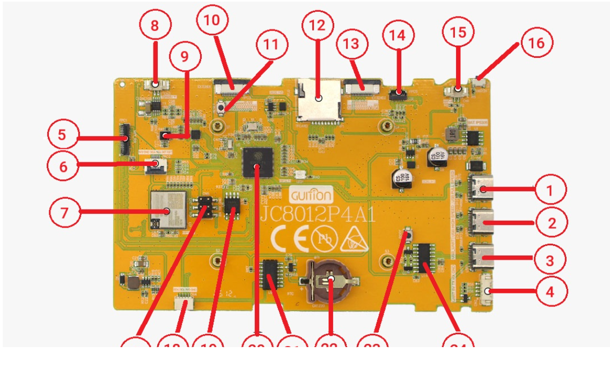

# Guition 10.1" ESP32-P4 (2026 version - new P4 chip, new touch ) videophone and Home Assistant dashboard

ESPHome firmware for the **Guition JC8012P4A1C_I_W_Y1** (ESP32-P4 10.1",
SKU 10153002-v3, batch 2635). It turns the panel into a SIP JPEG videophone
and a touch dashboard for Home Assistant.

**Profile:** VoIP only, single microphone with echo cancellation, landscape UI.

The configuration is [`guition10_1_esp32p4_board.yml`](guition10_1_esp32p4_board.yml).
It is based on [n-IA-hane/esphome-intercom](https://github.com/n-IA-hane/esphome-intercom)
(`yamls/voip-only/single-bus/waveshare-p4-touch-videophone-jpeg.yaml`), without
Voice Assistant, wake word, Sendspin, HTTP media or the runtime controller. It
adds the Guition hardware and an LVGL home page dashboard. The VoIP callbacks
drive the UI directly. Board-specific changes are marked `[GUITION]` in the YAML.

## Hardware

| Part | Details |
|---|---|
| SoC | ESP32-P4, production silicon (chip revision v3.x), 16 MB flash, 32 MB hex PSRAM |
| Wi-Fi | ESP32-C6 co-processor over SDIO |
| Display | 10.1" 800×1280 MIPI-DSI (JD9365), used in landscape |
| Touch | GSL3680 at I2C 0x40 |
| Audio | ES8311 codec (0x18), NS4150 amplifier (PA_CTRL GPIO20) |
| Camera | OV02C10 2 MP MIPI-CSI (0x36) |
| RTC | RX8025T (0x32) |
| Button | BOOT button, GPIO35 |

## Dimension

Panel: 241 x 156 mm

Screen: 216 x 135 mm

### Board layout



| No. | Part | No. | Part | No. | Part |
|---|---|---|---|---|---|
| 1 | USB Full Speed (USB1, P4) | 9 | Microphone | 17 | CN5 (ESP-Prog for the ESP32-C6) |
| 2 | USB High Speed (USB, P4) | 10 | EXTEND1 connector | 18 | CN4 (I2C, P4) |
| 3 | USB from UART0 (P4) | 11 | Reset button (P4) | 19 | W25Q128 SPI flash chip |
| 4 | CN2 (UART0, P4) | 12 | TF card holder | 20 | ESP32-P4 |
| 5 | LCD FPC (MIPI-DSI, P4) | 13 | EXTEND2 connector | 21 | RTC chip (RX8025T) |
| 6 | Touch CTP FPC | 14 | Camera FPC (MIPI-CSI, P4) | 22 | RTC battery |
| 7 | ESP32-C6 | 15 | Battery connector (3.7 V) | 23 | BOOT button (P4) |
| 8 | Speaker connector | 16 | Power button | 24 | USB-UART chip (CH340) |

### Pinout

| Function | Pins |
|---|---|
| Shared I2C (codec, touch, camera, RTC) | SDA GPIO7, SCL GPIO8 |
| ES8311 I2S | MCLK GPIO13, BCLK GPIO12, LRCK GPIO10, DIN GPIO11 (codec ASDOUT), DOUT GPIO9 (codec DSDIN) |
| ESP32-C6 SDIO | RESET GPIO54, CMD GPIO19, CLK GPIO18, D0–D3 GPIO14–17 |
| Display | Reset GPIO27, backlight GPIO23 (LCD_PWM to the MP3202 enable) |
| Touch | Reset GPIO22, interrupt GPIO21 |
| Speaker amplifier | GPIO20 (high = on) |
| BOOT button | GPIO35 (10 kΩ pull-up) |

## Audio

**Capture.** The ES8311 records in stereo: the microphone (MIC1) on the left
channel and the codec's own speaker output on the right, which is the echo
reference.

```
[ES8311 RX left: MIC1] + [ES8311 RX right: DAC feedback REF]
  -> esp_audio_stack 48 kHz -> 16 kHz
  -> aec_processor (esp_aec, echo cancellation only)
  -> mic_aec -> VoIP TX
```

**Playback.** Three sources are mixed into one 48 kHz mono stream.

```
[HA media] ----------> speaker_player -> media_speaker_input --------+
[HA TTS, ringtone] --> speaker_player -> announcement_speaker_input -+
[VoIP RX] -----------------------------> voip_speaker_input ---------+
                    (resamplers) -> audio_mixer 48 kHz mono -> hw_speaker
                                  -> ES8311 -> NS4150 amp -> speaker
```

The NS4150 amplifier is only on while audio plays. `esp_audio_stack` switches it
through `on_amplifier_required` and `on_amplifier_idle`, and it turns off 2 s
after playback stops. Left on while idle, the amplifier turns the DAC's idle
noise into an audible squeal.

## Touch UI

| Screen | What it shows |
|---|---|
| Home page | Home Assistant dashboard, Intercom card (VoIP), soil moisture, Frigate snapshots |
| Camera pages | Live RTSP, one camera per page. Open from the sidebar or by tapping a snapshot. |
| Settings page | Open from the sidebar or by swiping up. Swipe down to return. |
| Video call | Full-width remote video with a hang-up strip |

**BOOT button:** a short press answers, calls or hangs up. A long press (1–3 s)
toggles mic mute.

## Components

| Component | Source | Purpose |
|---|---|---|
| `gsl3680` | [`components/gsl3680`](components/gsl3680) (this repo) | Touch driver for the JC8012P4A1C panel |
| `mipi_dsi` | [`components/mipi_dsi`](components/mipi_dsi) (this repo) | The esphome-intercom `mipi_dsi`, patched for ESP32-P4 v3.x |
| `ov02c10` | [chickymonkey/camera_OV02C10_component](https://github.com/chickymonkey/camera_OV02C10_component) | Camera sensor driver |
| `esp_rtsp_stream` | [chickymonkey/Esp-rtsp-stream](https://github.com/chickymonkey/Esp-rtsp-stream) | Live RTSP camera pages |
| `voip_stack` | [n-IA-hane/esphome-voip-stack](https://github.com/n-IA-hane/esphome-voip-stack) | SIP calls and video |
| `esp_audio_stack`, `esp_aec` | [n-IA-hane/esphome-audio-stack](https://github.com/n-IA-hane/esphome-audio-stack) | Audio pipeline and echo cancellation |

### Touch driver (`gsl3680`)

The ESPHome `gsl3670` preset for this board loads touch firmware made for the
Seeed reTerminal D1001, which does not suit this panel. `gsl3680` is a port of
Guition's [`guition-jc/esp_lcd_touch_gsl3680`](https://components.espressif.com/components/guition-jc/esp_lcd_touch_gsl3680)
(MIT). The original needs ESP-IDF 6.1, so this port uses ESPHome's own I2C and
touchscreen code. It:

- loads Guition's controller firmware for the JC8012P4A1C and checks that the chip accepted it
- maps sensor coordinates to the panel and tracks and smooths each finger
- skips packets that carry flag bits instead of reading them as coordinates
- keeps the current touch when a read on the shared I2C bus fails, instead of reporting a release
- polls the chip every 50 ms instead of relying on the interrupt line

The controller firmware table (`components/gsl3680/gsl3680_firmware.h`) comes from
Guition and is **not** covered by the MIT licence; see
[`components/gsl3680/NOTICE`](components/gsl3680/NOTICE).

## Setup

1. **Secrets.** Add `wifi_ssid`, `wifi_password` and `camera_password` (the RTSP
   camera login) to your ESPHome `secrets.yaml`.
2. **Home Assistant entities.** Edit the substitutions at the top of the YAML to
   match your entities: heater, locks, garage door, power and energy,
   temperatures, soil moisture, scenes and Frigate snapshots. Set `ha_base_url`
   to an address this device can reach. Snapshots are fetched through Home
   Assistant's image proxy.
3. **Camera URLs.** Create `input_text.esp_camera_url` and
   `input_text.esp_camera_url_driveway` in Home Assistant with the two RTSP URLs.
4. **Home Assistant actions.** In the ESPHome device settings, allow the device
   to perform Home Assistant actions. The energy and soil history call
   `recorder.get_statistics`.
5. **VoIP video.** Install the VoIP Stack integration in Home Assistant. For
   video calls, open **VoIP Stack → Reconfigure** and enable **SIP video for
   the Home Assistant softphone**. Without it, calls are audio only.
6. **Soil history.** The sensor needs a `state_class` so that Home Assistant
   keeps long-term statistics for it. The two history values are the 9–10 am
   average of each day.

### Board revision

The YAML uses `board: esp32-p4_r3-evboard` with `engineering_sample: false` for
production v3.x silicon. A pre-v3 engineering sample needs
`board: esp32-p4-evboard` and `engineering_sample: true`. The boot log shows the
chip revision (`chip revision: vX.Y`) if you are unsure.

The display model `JC8012P4A1-V2` (70 MHz, 1.5 Gbps) is for the 2026 "New
Panel". The original panel uses `JC8012P4A1` (60 MHz, 1 Gbps).

### Camera resolution

The OV02C10 runs at 1920×1080 and the P4 can only downscale it in exact
1/16 steps. 960×540 (half size) is the size that works. 1200×675 is rejected by
the P4 video path, which then falls back to full 1080p and runs out of buffer
memory.
